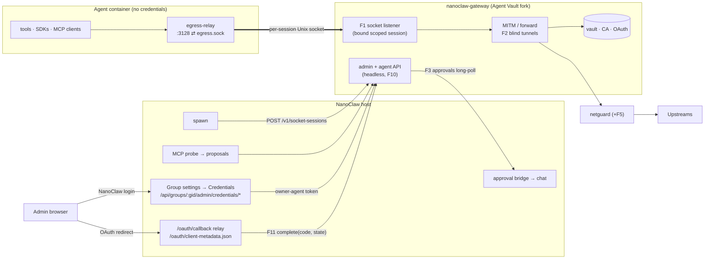

# Credential gateway via an Agent Vault fork

**Status:** proposal (alternative). **Date:** 2026-10-15. **Revision 2:** the
gateway is headless. Credentials are managed in NanoClaw's agent group settings
through a gateway admin API, and the operator configures the gateway through
`.env`. Agent Vault's web UI and email/password accounts are not used.
**Revision 3:** one vault per agent group. Keys shared between groups are
duplicated, with copy and fan-out support ([§6.2](#62-keys-shared-across-groups)).

This proposal reaches the same goals as
[credential-gateway-proposal.md](credential-gateway-proposal.md) (the "native
proposal") but takes a different route. Instead of porting ideas to TypeScript,
**fork [Infisical Agent Vault](https://github.com/Infisical/agent-vault) and run
it as the gateway service.** Several parts of the native proposal carry over
unchanged:

- §1, goals and non-goals
- §2.1, the topology, lifecycle and trust model
- §4.6, the agent contract

This document covers only what differs.

## 1. Decision summary

- **What to fork:** Agent Vault v0.40.0 (commit `872578e4cdf9`) into
  `dtreskunov/agent-vault`, on a `nanoclaw` branch.
- **How to run it:** as `nanoclaw-gateway`, a single static Go binary.
- **Where new code goes:** NanoClaw-specific and MCP features go into **new
  packages**, with small hooks in core files. Each change is offered upstream.
- **Headless gateway:**
  - The fork drops Agent Vault's web UI and human accounts (registration,
    email/password login, invites, SMTP) (F10).
  - Its only client is the NanoClaw host, using an instance-owner agent token
    created at first boot.
  - Nothing about the gateway is exposed publicly.
- **Configuration:** operators set instance-level settings (master password,
  network allowlist, OAuth app clients, retention) in `.env`. Day-to-day
  credential management lives in **group settings → Credentials** in the
  NanoClaw UI, backed by the gateway admin API.
- **What NanoClaw keeps or adds:**
  - spawn integration
  - the in-container relay
  - the approval bridge
  - the Credentials tab and MCP-tab integration
  - the OAuth callback relay
  - the setup skill
- **What NanoClaw doesn't build:** a vault, a certificate authority (CA) or a
  proxy.
- **First step:** a time-boxed spike ([§9](#9-plan)) with explicit go/no-go
  criteria before any rollout work.

## 2. What upstream already provides

Verified against the pinned commit:

- **Code:** 181 Go files (~1.15 MB) and 58 test files (~0.84 MB).
- **Activity:** 17 contributors, 53 commits in the last 90 days, roughly monthly
  releases.
- **License:** MIT. LICENSE mentions `ee/` directories, but none exist.

| Capability            | Upstream                                                                                                                                                                                                                   |
| --------------------- | -------------------------------------------------------------------------------------------------------------------------------------------------------------------------------------------------------------------------- |
| Vault                 | AES-256-GCM. A data key (DEK) is wrapped by a key derived from a master password with Argon2id. Agents with the proxy role can never read values.                                                                          |
| CA                    | Root key encrypted with the data key and stored in the DB; ECDSA P-256 leaves valid 24 h, kept in an LRU cache                                                                                                             |
| Proxy                 | CONNECT with TLS interception, plain-HTTP forwarding, streaming responses, WebSocket, size limits, slow-client timeouts                                                                                                    |
| Injection             | Services matched on `host[:port][/path-glob]`. Auth types: `bearer`, `basic`, `api-key` (header + prefix), `custom` (header templates), `passthrough`. Placeholder substitution in header, query, path, body or WebSocket. |
| OAuth                 | "Connect" with any provider (authorization code + PKCE) or pasted tokens; refresh 5 min before expiry, with concurrent refreshes merged                                                                                    |
| Network guard         | Each dialed IP is checked as the connection is made (defeats DNS rebinding). Cloud metadata IPs are always blocked; private ranges are blocked unless allowlisted.                                                         |
| Agent-raised requests | **Proposals:** the agent asks for a service or credential slot, and a human approves. Pending proposals expire after 7 days; approval can be done over the API by a vault `admin`/`member`.                                |
| Identity              | Users and agents with instance roles; per-vault roles `admin`, `member` and `proxy`; **scoped sessions** with the proxy role (5 min–7 d) minted by a privileged agent                                                      |
| Operations            | REST API (agent tokens with the right roles can do everything the UI does), CLI, request log with retention, rate limiting, SQLite (pure Go) or Postgres                                                                   |
| Not useful to us      | React admin UI and human accounts (register/login, invites, password reset, SMTP), container isolation for `vault run` (iptables, needs `NET_ADMIN`), Infisical sync, PostHog telemetry (on by default)                    |

## 3. Architecture

**How NanoClaw concepts map onto Agent Vault:**

| NanoClaw / OneCLI                             | Agent Vault                                                                                                                                                                                                                       |
| --------------------------------------------- | --------------------------------------------------------------------------------------------------------------------------------------------------------------------------------------------------------------------------------- |
| The NanoClaw host process                     | Agent `nanoclaw-host` with the instance `owner` role and vault `admin` on every vault, created at first boot (F10). Values stay write-only (F6).                                                                                  |
| A session                                     | A socket-bound scoped session (F1), revoked when the session ends                                                                                                                                                                 |
| Which credentials a group can use             | **One vault per agent group**, named after the group ID (`ag-…`). Keys shared between groups (e.g. OpenRouter) are duplicated in each vault (§6.2). OneCLI agents are already one per group, so their grants carry over directly. |
| OneCLI secret + host/path pattern             | Credential + service                                                                                                                                                                                                              |
| OneCLI app connection                         | OAuth credential plus services for each API host                                                                                                                                                                                  |
| Owner/admin managing or approving credentials | NanoClaw roles, enforced by the host (§6). The gateway sees only the host's owner-agent token.                                                                                                                                    |
| `request_credential` tool                     | An Agent Vault proposal created through the socket (F1 API passthrough), using upstream's agent skill                                                                                                                             |

## 4. Fork changes

Sizes are estimates of new code. "Core diff" is the change to existing upstream
files, which is what causes merge conflicts.

| #   | Change                                                                                                                                                                                                                                                                                                         | Why                                                                                                                   | Size / core diff                          | Upstream?                            |
| --- | -------------------------------------------------------------------------------------------------------------------------------------------------------------------------------------------------------------------------------------------------------------------------------------------------------------- | --------------------------------------------------------------------------------------------------------------------- | ----------------------------------------- | ------------------------------------ |
| F1  | **Socket-bound sessions** (details below)                                                                                                                                                                                                                                                                      | Identity comes from the socket, with no token in the container ([why](credential-gateway-proposal.md#2-architecture)) | M / small                                 | Yes: generic for local orchestrators |
| F2  | **Blind tunnels:** if no service in the session's vault matches the CONNECT host, splice raw TCP through the network guard instead of terminating TLS. Setting `unmatched_host_mode = tunnel \| mitm \| deny`.                                                                                                 | Certificate-pinned clients and bulk downloads work; less traffic is inspected                                         | S / small (`handleConnect`)               | Yes                                  |
| F3  | **Per-request approvals:** services get `approval: allow \| ask` plus `(method, path-glob)` rules. An `ask` holds the request, publishes it on `GET /v1/approvals?wait=`, and is decided by `POST /v1/approvals/{id}` from a vault member or the host agent with an `approver` flag. A timeout counts as deny. | Parity with OneCLI approval cards                                                                                     | M / small (hook in `forwardRequest`)      | Yes                                  |
| F4  | **MCP OAuth** (details below)                                                                                                                                                                                                                                                                                  | The main new feature                                                                                                  | L / small                                 | Yes                                  |
| F5  | **Network guard additions:** also block NAT64 (`64:ff9b::/96`, `64:ff9b:1::/48`), 6to4, Teredo and the host's own IPs (ported from smokescreen, MIT); per-vault private allowlist                                                                                                                              | Closes IPv6 bypasses; lets the Home Assistant LAN host be allowed for one group only                                  | S / small (`netguard.go`)                 | Yes                                  |
| F6  | **Instance setting `reveal_disabled` (required):** turns off `credential get --reveal` and `list --reveal` for every role, including owners                                                                                                                                                                    | The host's owner token must not be able to read values                                                                | S / small                                 | Likely                               |
| F7  | **Sealed bindings:** a credential's allowed hosts are part of its ciphertext's authenticated data, so services can only reference it on those hosts                                                                                                                                                            | Needed only for topology B (separate VM)                                                                              | M / medium                                | Maybe                                |
| F8  | **Token-endpoint stubs:** a service type for `oauth2.googleapis.com/token` and similar that answers refresh requests carrying the placeholder refresh token with a synthetic token, without contacting the upstream                                                                                            | stdio MCP servers using credential stubs (Gmail, Calendar)                                                            | S / small                                 | Maybe                                |
| F9  | **Fork hygiene:** telemetry off by default plus a `notelemetry` build tag; a CI check that fails if an `ee/` directory appears                                                                                                                                                                                 | Privacy, license safety                                                                                               | XS / tiny                                 | No                                   |
| F10 | **Headless mode** (details below)                                                                                                                                                                                                                                                                              | No second UI or login; configured through `.env`                                                                      | M / small (route registration, bootstrap) | Maybe: "API-only server"             |
| F11 | **OAuth redirect relay and env-configured OAuth apps** (details below)                                                                                                                                                                                                                                         | The NanoClaw UI hosts the browser-facing OAuth endpoints, so the gateway stays private                                | S / small (`handle_oauth.go`)             | Yes                                  |
| F12 | **Copying credentials inside the gateway:** `POST /v1/vaults/{dst}/credentials/copy {from_vault, keys}` re-encrypts within the gateway, so values never leave it. Copies record `copied_from` (vault, key, time). Static credentials only.                                                                     | Duplicating shared keys into another group without re-entering them (F6 blocks reading them back)                     | S / none (new package on the store API)   | Maybe                                |

**F1 details.**

- **Minting:** `POST /v1/socket-sessions {vault, label, dir}`, authenticated with
  the host agent's token, mints a proxy session and binds `<dir>/egress.sock`.
  `dir` must sit under `AGENT_VAULT_SOCKET_ROOT`.
- **Lifetime:** the session renews itself internally until `DELETE`, working
  around the 7-day cap.
- **The socket listener:**
  - serves CONNECT and plain-HTTP forwarding,
  - ignores `Proxy-Authorization` and always uses the bound session,
  - is exempt from rate limiting the same way loopback peers are,
  - passes requests for the reserved host `agent-vault.internal` to the API, so
    agents can call `/discover` and create proposals.

**F10 details.**

- **UI and accounts off:** `AGENT_VAULT_HEADLESS=true` (also a `noui` build tag)
  stops serving `web/` and turns off user register/login, invites, password
  reset and SMTP.
- **Bootstrap:** on first boot the gateway creates the `default` vault and the
  instance-owner agent `nanoclaw-host` (vault `admin`). It writes that agent's
  token to `AGENT_VAULT_BOOTSTRAP_TOKEN_FILE` (0600).
- **Token rotation:** `agent-vault agent rotate nanoclaw-host` on the gateway
  machine.
- **Loading `.env`:** `--env-file <path>` loads **only** `AGENT_VAULT_*` keys,
  so NanoClaw's other secrets in the same `.env` never reach the gateway's
  environment.

**F11 details.**

- **Redirect target:** `AGENT_VAULT_OAUTH_REDIRECT_URL` replaces upstream's
  hard-coded `<baseURL>/v1/oauth/callback`.
- **Relay endpoint:** `POST /v1/oauth/complete {state, code}` returns JSON
  instead of redirecting to Agent Vault's UI.
- **Client metadata:** `GET /v1/oauth/client-metadata` returns the CIMD document
  for NanoClaw to publish.
- **Pre-registered OAuth apps from env:** declared as
  `AGENT_VAULT_OAUTH_APPS=google`, with `AGENT_VAULT_OAUTH_GOOGLE_CLIENT_ID` and
  `AGENT_VAULT_OAUTH_GOOGLE_CLIENT_SECRET_FILE`. Connect requests refer to the
  app by name, so the UI never handles client secrets.

**F4 details.**

- **New proposal and credential kind** `mcp_oauth { resource_url }`.
- **Discovery:** RFC 9728 (protected resource), then RFC 8414 (authorization
  server), falling back to OIDC discovery.
- **Client registration**, in order of preference: CIMD (the gateway generates
  the client metadata document and NanoClaw publishes it, F11), then dynamic
  registration (RFC 7591), then a manually entered client.
- **Sign-in:** PKCE plus `resource` (RFC 8707). Refreshes include `resource`.
- **Result:** a service auto-created for the MCP URL's host and path prefix.
- **Hiding the challenge:** strips `resource_metadata` from 401s on MCP services,
  so in-container SDKs don't start their own OAuth flow.
- **Reused code:** the `oauthex` package is vendored from the
  [MCP Go SDK](https://github.com/modelcontextprotocol/go-sdk) v1.8.0 (MIT moving
  to Apache-2.0; NOTICE kept). It provides resource/auth-server metadata,
  `ParseWWWAuthenticate`, `RegisterClient` and CIMD validation. Vendoring avoids
  pulling in the SDK's dependency tree.

**Not changed:**

- **Error format:** NanoClaw adopts upstream's codes (`service_not_found` hints,
  `oauth_not_connected`, `oauth_refresh_failed`, `credential_not_found`) instead
  of patching them.
- **Locked-down egress:** comes from NanoClaw's `--network none` plus F1, not
  from upstream's iptables-based isolation.
- **Topology B transport:** a host-side forwarder adding a per-session token in
  `Proxy-Authorization` is upstream's normal mode, so it needs no transport
  change.

## 5. Operator configuration (`.env`)

Instance-level settings are environment variables. The gateway unit runs
`agent-vault server --env-file <nanoclaw>/.env`, which reads only `AGENT_VAULT_*`
keys (F10). Edit `.env`, then run `systemctl --user restart nanoclaw-gateway`.
On a separate VM (topology B), a local `.env` works the same way.

Secrets can be given as `*_FILE` variants (added by F10), pointing at systemd
`LoadCredential=` files encrypted with `systemd-creds`. Plain values in `.env`
also work, but are then stored unencrypted on disk.

| Setting           | Variable                                                                    | This install                                                          |
| ----------------- | --------------------------------------------------------------------------- | --------------------------------------------------------------------- |
| Headless mode     | `AGENT_VAULT_HEADLESS`                                                      | `true` (required)                                                     |
| Master password   | `AGENT_VAULT_MASTER_PASSWORD_FILE`                                          | `systemd-creds` credential; passwordless mode is not used             |
| Host token output | `AGENT_VAULT_BOOTSTRAP_TOKEN_FILE`                                          | `data/agent-vault/host-token`                                         |
| Socket root       | `AGENT_VAULT_SOCKET_ROOT`                                                   | `data/agent-vault/sessions`                                           |
| Write-only values | `AGENT_VAULT_REVEAL_DISABLED`                                               | `true` (required)                                                     |
| OAuth redirect    | `AGENT_VAULT_OAUTH_REDIRECT_URL`                                            | `<UI_BASE_URL>/oauth/callback`                                        |
| OAuth apps        | `AGENT_VAULT_OAUTH_APPS`, `…_<APP>_CLIENT_ID`, `…_<APP>_CLIENT_SECRET_FILE` | `google`                                                              |
| Unmatched hosts   | `AGENT_VAULT_UNMATCHED_HOST_MODE`                                           | `tunnel` (per-vault override in the UI)                               |
| Private networks  | `AGENT_VAULT_NETWORK_ALLOWLIST`                                             | `10.0.1.105/32` (Home Assistant) until F5's per-vault allowlist lands |
| Telemetry         | `AGENT_VAULT_TELEMETRY`                                                     | `false`                                                               |
| Request logs      | `AGENT_VAULT_LOGS_MAX_AGE_HOURS`                                            | `720`                                                                 |
| Rate limiting     | `AGENT_VAULT_RATELIMIT_PROFILE`                                             | `default`                                                             |
| Listeners         | `AGENT_VAULT_ADDR` and listener settings                                    | Loopback only; no reverse-proxy route to the gateway                  |

**Host side:**

- `NANOCLAW_GATEWAY_URL` (default `http://127.0.0.1:14321`) and
  `NANOCLAW_GATEWAY_TOKEN_FILE` tell NanoClaw where the gateway is.
- The host token file is read only by the host's gateway client. It is never
  mounted into containers.

## 6. NanoClaw changes (this repo)

- **Spawn:**
  - [container-runner.ts](../src/container-runner.ts) replaces
    `onecli.applyContainerConfig` with `POST /v1/socket-sessions` for the
    group's vault (`ag-<id>`).
  - It mounts the socket directory and the CA bundle and sets the proxy and CA
    env, as in native §4.1.
  - A failure refuses the spawn, as today.
- **Group lifecycle:**
  - Creating an agent group creates its vault.
  - Deleting a group deletes its vault.
  - Archiving a group keeps its vault so a restore works.
- **Relay:** `container/agent-runner/src/egress-relay.ts`, the same as in the
  native proposal.
- **Gateway client:** `src/modules/credentials/agent-vault-client.ts` is the
  only code that holds the host token. The UI server, `ncl`, spawn and the
  approval bridge all go through it.
- **Approvals:** [onecli-approvals.ts](../src/modules/approvals/onecli-approvals.ts)
  becomes `agent-vault-approvals.ts`, which long-polls F3 and keeps the card
  flow. Cards and proposal notifications deep-link to the Credentials tab
  (`?tab=credentials&request=<id>`).
- **MCP OAuth trigger:** the existing MCP **Test** action
  (`/mcp-servers/test`) and `mcp-probe` notice a 401 that carries
  `resource_metadata`. The MCP tab then offers **Connect**.
- **Container skill:** `onecli-gateway` is replaced by `credential-gateway`,
  which wraps upstream's agent skill (proposals, `/discover`) and its error codes.
  [upload-trace.ts](../container/agent-runner/src/upload-trace.ts) is updated
  for those codes.
- **Host-side calls:** use the host token with the loopback MITM port, replacing
  [onecli-proxy.ts](../src/ui/server/chat/onecli-proxy.ts).
- **Stubs** are written by the host. They contain no secrets.
- **`ncl credentials`** (host only): `list`, `set --value-stdin`, `delete`,
  `services …`, `copy …`. Container `ncl` rejects these verbs regardless of
  `cli_scope`.
- **Setup:** `/init-agent-vault` replaces `/init-onecli`. It:
  - downloads a pinned release binary and verifies its SHA-256,
  - writes the unit with `--env-file`,
  - adds the `AGENT_VAULT_*` defaults from §5 to `.env`, asking for OAuth app
    client IDs if wanted,
  - creates the encrypted master password,
  - starts the service, picks up the bootstrap token and creates a vault for
    each existing agent group.

  There are no user accounts and no public route to the gateway.

- **Uninstall and `/debug`:** updated for the new service.

### 6.1 Group settings → Credentials

There's a new `credentials` tab in
[GroupAdmin.tsx](../src/ui/client/chat/src/components/GroupAdmin.tsx), hidden
until `credentialsUiEnabled` is on. The MCP server editor
([GroupAdminMcp.tsx](../src/ui/client/chat/src/components/GroupAdminMcp.tsx))
gains a **Sign-in** row for HTTP servers. It shows whether the server uses a key
or a sign-in and offers **Sign in**, or links to the key in Credentials.
Routes extend the existing `/api/groups/:gid/admin/*` dispatcher in
[group-admin.ts](../src/ui/server/chat/group-admin.ts).

The UI uses plain-language names: **keys** (gateway credentials), **accounts**
(OAuth connections), **rules** (services), **requests** (proposals) and
**network** (egress policy). The wire contract is in
[GroupAdminCredentialsApi.ts](../src/ui/client/chat/src/components/GroupAdminCredentialsApi.ts),
and a mocked fixture of the whole tab is described in
[ui.md](ui.md). All routes are under `…/admin/credentials`:

| View     | Shows / does                                                                                                                                                                                                                                   | Host routes                                                                                                                       | Gateway API                                      |
| -------- | ---------------------------------------------------------------------------------------------------------------------------------------------------------------------------------------------------------------------------------------------- | --------------------------------------------------------------------------------------------------------------------------------- | ------------------------------------------------ |
| Requests | Pending agent proposals: fill in each credential slot (or copy it from another group), sign in for account requests, approve or decline                                                                                                        | `POST /requests/:id/approve {values, copyFrom}`, `POST /requests/:id/reject`                                                      | Approve/reject proposals                         |
| Keys     | Name, key name, needs-value / out-of-date status, hosts it's sent to, last used, copied-from and also-in groups. Add (preset or custom; optionally to other groups too), replace (optionally in other groups), copy to or from groups, delete. | `POST /keys`, `PUT /keys/:key {value, alsoGroups}`, `POST /keys/copy`, `POST /keys/:key/share`, `DELETE /keys/:key`, `GET /peers` | Set/delete credentials (no reveal, F6); F12 copy |
| Accounts | OAuth accounts and MCP sign-ins: status, access, last used; connect, change access, reconnect, disconnect                                                                                                                                      | `POST /accounts/start` → `{state, authorizeUrl}`, `GET /accounts/start/:state`, `DELETE /accounts/:key`                           | F11 connect; F4                                  |
| Rules    | Host/path match, how the key is sent, approval mode (allow, ask before changes, ask always, ask for listed calls), pause/resume                                                                                                                | `POST /rules`, `PUT /rules/:name`, `DELETE /rules/:name`                                                                          | Set/delete services; F3                          |
| Activity | Recent requests: time, method, host, path, outcome, key, thread; filters for key use and problems                                                                                                                                              | `GET /activity?filter=&before=`                                                                                                   | Request log                                      |
| Network  | Unmatched requests (allow without a key, or block), private-network allowlist; operator-wide entries shown read-only                                                                                                                           | `PUT /network`                                                                                                                    | Vault settings; F5                               |

`GET /credentials` returns everything the tab needs in one call, including the
MCP servers' sign-in status that the MCP tab shows. When the gateway is down,
every route answers `503 {error: "gateway_unreachable"}`, and the tab shows an
operator hint instead of data.

**OAuth callback.** There are two global UI-server routes: `GET /oauth/callback`
and `GET /oauth/client-metadata.json` (the latter is served from F11).

- **Start:** `POST …/credentials/accounts/start` records `state → (user, group)`
  with a 10-minute expiry and returns the authorize URL, which the UI opens in a
  popup.
- **Callback:** completes only for the **same signed-in NanoClaw user**.
  - It forwards `{code, state}` to `POST /v1/oauth/complete`.
  - It then returns the user to the tab.
- **Why this is safe:**
  - **No account injection:** a leaked authorize link can't bind someone else's
    account, because the callback only completes for the user who started it.
  - **The host can't redeem the code:** the PKCE verifier and client secret
    never leave the gateway.

**Permissions** (enforced by the host; the gateway trusts the host token). Each
vault belongs to exactly one group, so the rules follow NanoClaw's group roles:

- **Viewing the tab or changing the group's own vault** (secrets, services,
  connections, egress, approving requests): a scoped admin of the group, an
  owner or a global admin.
- **Copying from another group, or setting a value in other groups too:** the
  actor must be allowed to change every target group. For a copy, they must
  also be an admin of the source group, because a copy lets the target group
  use that secret.
- **Handling of values:**
  - never returned by any route,
  - request bodies containing values are never logged,
  - NanoClaw's audit log records only actor, action, key and the affected
    groups.

### 6.2 Keys shared across groups

- **Duplication is explicit.** Each group's vault holds its own copy, so a key
  set in one group can never be used by another. That's stronger isolation than
  shared vaults would give.
- **Adding an existing key to another group:** **Copy from group…** uses F12.
  The value stays inside the gateway and nobody re-enters it. Migration uses the
  same path.
- **Rotating a key:** when setting a key, the Secrets section lists the other
  groups that hold the same key name (with their `copied_from`) and offers
  **Also update in these groups**. The host sends the new value to each vault;
  the value passes through the host once, as for a single set.
- **Stale copies:** a copy whose `copied_from` is older than the source's last
  update shows a warning, and the Secrets section links to the other copies.
- **OAuth connections are not copied.** Providers that rotate refresh tokens
  would make the copies invalidate each other. Each group connects its own
  account instead:
  - Providers usually remember consent, so re-connecting an already-approved
    account is typically one click.
  - Google allows up to 100 refresh tokens per account per OAuth client, which
    is plenty for this install's groups.

## 7. Maintaining the fork

- **Branch model:** the `nanoclaw` branch is rebased onto each upstream release
  tag. Fork commits are kept as one commit per F-change.
- **Code placement:** new code goes in `internal/nanoclaw/`, `internal/mcpauth/`,
  `internal/approval/` and `internal/sockets/`. Core files get only short hooks
  behind interfaces.
- **Upstream PRs:** F1–F6 and F10–F11 are offered upstream once the spike is
  green. Every accepted PR removes fork surface.
- **CI on every sync:**
  - upstream `go test ./...`, `govulncheck`, `go vet`
  - NanoClaw contract tests (spawn → socket → injection → approval)
  - builds for linux/amd64, linux/arm64 and darwin/arm64
  - signed `SHA256SUMS`
- **Supply chain:** this mirrors the pnpm policy.
  - Builds use `go.sum` with `-mod=readonly`.
  - New modules need human approval.
  - Dependency diffs are reviewed at each sync.
  - `golang.org/x/*` updates are accepted only through upstream syncs.
- **Cadence:** sync within 7 days of an upstream release, and immediately for
  security fixes.

## 8. Migrating the current OneCLI inventory

| Current (OneCLI)                                                                           | Agent Vault service                                                                                                                          |
| ------------------------------------------------------------------------------------------ | -------------------------------------------------------------------------------------------------------------------------------------------- |
| Bearer `Authorization` (MiniMax ×3, Vercel AI Gateway, Apify, Linear, OpenRouter)          | `bearer`                                                                                                                                     |
| Path-scoped bearer: domagent `/mcp/bananaclawz`, budget `/http`, Home Assistant `/api/mcp` | `bearer` with a path glob                                                                                                                    |
| NextCloud `Basic {value}` (pre-encoded)                                                    | `custom`: `Authorization: Basic {{ NEXTCLOUD_MCP }}`, path `/mcp/*`                                                                          |
| Seattle Open Data `X-App-Token`                                                            | `api-key` with header `X-App-Token`                                                                                                          |
| Tavily query parameter `tavilyApiKey`                                                      | Query substitution; the MCP URL becomes `…/mcp/?tavilyApiKey=__TAVILY_API_KEY__`                                                             |
| `anthropic` type (api.anthropic.com, api.minimax.io)                                       | `api-key` with `x-api-key`, or a `custom` Bearer + beta header for OAuth tokens. Merge the two overlapping api.minimax.io entries.           |
| 7 Google apps × 2 accounts                                                                 | One OAuth credential per account with the union of scopes, connected in each group that uses it (§6.2), plus one service per Google API host |

**How the migration runs:** `scripts/migrate-from-onecli.ts` reads
`onecli secrets list` and each OneCLI agent's grants (metadata only). OneCLI
agents are one per group, so for each group it creates that group's services and
one proposal with credential slots for the keys it was granted.

- The operator enters each distinct value once, in any one group, under
  **Credentials → Requests**.
- The other groups that need it are filled with **Copy from group…** (F12).
- Google accounts are connected per group from **Credentials → Connections**.

## 9. Plan

**Spike (go/no-go before anything else):** build F1, F2 and the F10 bootstrap,
with a minimal NanoClaw integration (spawn, plus `ncl credentials set` in place
of the UI) for one canary group.

| Criterion    | Pass if                                                                                                                                            |
| ------------ | -------------------------------------------------------------------------------------------------------------------------------------------------- |
| Functional   | Anthropic or MiniMax, Tavily (query), NextCloud (custom Basic), domagent (path-scoped), Linear MCP and blind tunnels (models.dev, GitHub) all work |
| Fork surface | ≤ 300 changed lines in upstream files (F1, F2, F10 together); the rest in new packages                                                             |
| Syncability  | Rebases cleanly onto upstream `main` at spike end; upstream tests pass                                                                             |
| Overhead     | Added p50 latency on the intercepted path < 5 ms on the host                                                                                       |
| Ops          | Static binary; headless, unattended boot from `.env` with an encrypted master password; no listener reachable from outside the host                |

**If the spike fails, fall back to the native proposal.** Its building-block
analysis still applies.

**Phases after a go:**

| Phase         | Scope                                                                                                                                                                                                          |
| ------------- | -------------------------------------------------------------------------------------------------------------------------------------------------------------------------------------------------------------- |
| P1            | F1, F2, F5, F6, F9, F10, F12, NanoClaw integration with per-group vaults, Credentials tab (Secrets with copy and fan-out, Services), `ncl credentials`, per-group `credential_backend = onecli \| agent-vault` |
| P2            | F3 approvals and the bridge; Credentials tab Requests and Activity                                                                                                                                             |
| P3            | F11, Google OAuth through Credentials → Connections, F8 stubs                                                                                                                                                  |
| P4            | F4 MCP OAuth; MCP-tab auth status and Connect, probe trigger                                                                                                                                                   |
| P5            | Migration script, cutover                                                                                                                                                                                      |
| P6            | Remove OneCLI                                                                                                                                                                                                  |
| P7 (optional) | Topology B (forwarder + upstream token mode) plus F7 and the tighter host role (§11)                                                                                                                           |

Each phase has the same exit criteria as the native proposal's matching phase.

## 10. Comparison with the native proposal

|                            | Agent Vault fork                                                                                       | Native (TypeScript)                           |
| -------------------------- | ------------------------------------------------------------------------------------------------------ | --------------------------------------------- |
| Code to write              | NanoClaw integration and Credentials UI, MCP OAuth, approvals, headless mode                           | Proxy, CA, vault, OAuth, plus all of the left |
| Test coverage from day one | Upstream suite (~0.84 MB of tests)                                                                     | Only what we write                            |
| Admin UI                   | NanoClaw group settings → Credentials (gateway is headless)                                            | NanoClaw group settings → Credentials         |
| Security fixes             | Cherry-picked from upstream                                                                            | Ours alone                                    |
| Language and toolchain     | Go, a second supply-chain policy                                                                       | TypeScript, existing pnpm policy              |
| Control over the design    | Shaped by upstream's model (one vault per session, so one vault per group with duplicated shared keys) | Full                                          |
| Topology B                 | Transport native to upstream; admin still flows through the host (§11)                                 | Has to be built                               |

## 11. Risks and open questions

1. **Upstream drift.** Agent Vault is pre-1.0, and Infisical sells an enterprise
   edition. Features could move to `ee/` or the architecture could change.
   - **Mitigation:** the MIT snapshot stays usable indefinitely.
   - **Mitigation:** keep the fork small.
   - **Mitigation:** the F9 CI check catches `ee/` changes.
2. **Duplicated shared keys.** Rotating a shared key means updating every copy.
   - **Mitigations:** fan-out set, `copied_from` tracking and stale-copy
     warnings (§6.2).
   - **Later option:** a "layered vaults" fork change could remove the
     duplication.
3. **The host holds an instance-owner token.**
   - **What a compromised host could do:** set values, retarget services,
     approve requests and create vaults.
   - **What it couldn't do:** read values, because of F6.
   - **Topology A:** this matches the existing trust model (the host already
     controls Docker).
   - **Topology B:** narrow it:
     - the host token gets only vault `member` (no instance owner),
     - vault creation and deletion move to the gateway CLI on the VM,
     - F7 sealed bindings stop services being retargeted to other hosts.
4. **Headless mode is fork surface.** F10 touches route registration and
   bootstrap. If upstream doesn't accept an API-only mode, it's carried long
   term, so keep it to a build tag plus one bootstrap package.
5. **The master password protects data at rest only.** With topology A, a
   compromised host can still read process memory. This is the same trust model
   as native §2.1.
6. **Go expertise is needed** for reviewing upstream syncs.
7. **Open question:** do F3 approvals need "approve for N minutes" from day one,
   or is per-call enough to start?
