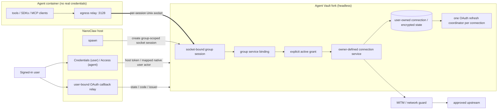

# Credential gateway via an Agent Vault fork

**Status:** plan of record. **Originally proposed:** 2026-10-15.
**Revision 7:** 2026-10-29. User-owned credentials and OAuth connections,
explicit shared references, and a user-scoped **Credentials** page replace
duplicated group-owned credentials. **F12 copying is removed, not deferred.**
Ownership reuses native AgentVault users and actors, provisioned from NanoClaw
identities without enabling gateway human login.

This revision supersedes revisions 2-6 on ownership, sharing, OAuth client
lifecycle, UI placement and rollout. It specifies the target contract, not a
claim that the deployed gateway already implements it. Existing release and
[spike acceptance notes](credential-gateway-spike.md) remain historical evidence.

The [native proposal](credential-gateway-proposal.md) is an architectural
alternative and source of transport/trust-model analysis, not a second plan of
record. Its per-group credential-management and migration contracts do not
override this document.

## 1. Decision summary

- **Gateway:** continue the `dtreskunov/agent-vault` fork on `bananaclaw`, based
  on Infisical Agent Vault v0.40.0 (`872578e4cdf9`). Reuse its encryption, CA,
  proxy, network guard and supported protocol implementations.
- **Keep working infrastructure:** headless operation, write-only values,
  NanoClaw's host gateway client, per-container socket sessions, group egress
  isolation, OAuth discovery/PKCE and the callback relay.
- **Ownership:** a NanoClaw user maps to a native AgentVault user who owns a
  personal library vault and reusable connections. Static values or OAuth
  authorization state are stored once in that library.
- **Authorization:** each group has its own vault and socket identity, with
  explicit grants to selected connection services. A vault is an authorization
  boundary, not the owner or storage location of every secret it uses.
- **UI:** the account menu's **Credentials** entry, immediately after
  **My Profile**, opens a user-scoped page for keys, connected accounts and
  sharing. Agent Settings contains the same **Credentials** table scoped to its agent.
- **Sharing:** references cover both static credentials and OAuth connections
  in R1. There is no implicit inheritance from `default`, no cross-vault
  fallback, and no copy/fan-out synchronization feature.
- **Clean break:** replace superseded contracts introduced during fork
  development. Do not retain runtime compatibility code for earlier fork
  iterations. Coordinated deployment and a reviewed offline state conversion
  preserve useful live state without making it a permanently supported model.
- **Headless trust model:** user records and native actor/vault authorization
  remain useful without human gateway login. NanoClaw authenticates users;
  its host authenticates transport to the gateway and supplies an explicitly
  authorized effective native user actor. Containers never hold that token.

### 1.1 R1 scope

| In R1                                                                                                                                               | Deferred or excluded                                                                                                     |
| --------------------------------------------------------------------------------------------------------------------------------------------------- | ------------------------------------------------------------------------------------------------------------------------ |
| Native managed users, personal library vaults and user-owned static connections, including Basic pairs and multi-header sets; enter and rotate once | F12 copying, `copied_from`, fan-out updates and duplicated per-group values are **removed**                              |
| User-owned provider and MCP OAuth connections, shared by explicit references, with one refresh/client lifecycle per connection                      | Automatic account merging, automatic scope union, ownership transfer and cross-user delegation are not implicit features |
| Connection services defining approved destinations and authentication; per-group grants and local bindings                                          | F3 per-request approvals and arbitrary per-method/path rule editors                                                      |
| Top-level Credentials, agent Access, matching host-only CLI and authenticated host API                                                              | Agent-raised credential proposals and a full activity UI                                                                 |
| Generic install-wide OAuth apps and user-owned private apps; connection-pinned app bindings, DCR/CIMD, F8 placeholders                              | A provider permission catalog or old-catalog compatibility                                                               |
| Group-local sockets, explicit errors, grant revocation without container restart, audited ownership and use                                         | F5 per-group network restrictions; sealed bindings/topology B remain separate work                                       |
| Reviewed state adoption, workload acceptance and complete OneCLI retirement                                                                         | Old/new API negotiation, dual-write models or permanent adapters for superseded fork behavior                            |

Unmatched CONNECT destinations retain the operator-approved tunnel policy.
Private-network access follows the gateway's approved instance configuration;
this revision does not silently change it or claim per-group network isolation
beyond the socket/grant boundaries.

## 2. What upstream provides and what we retain

The pinned upstream was reviewed as 181 Go source files and 58 test files.
Retain the useful foundations rather than implementing a second proxy:

- AES-256-GCM encrypted credential storage and master-password handling.
- A persistent local root CA, TLS interception and credential attachment.
- Bearer, Basic, API-key, custom-header and explicitly scoped placeholder
  substitution recipes; HTTPS-only enforcement for credentialed services.
- Host/port/path matching, disabled services and network-guard checks at dial.
- Instance/vault agent identities, scoped proxy sessions and request logs.
- Static binaries, SQLite/PostgreSQL support and the existing test foundation.

Reuse native AgentVault user records, actors, vault memberships and role checks;
do not build a parallel owner/principal directory. Provisioning an externally
managed user is distinct from enabling a password account. The host remains
trusted; connection ownership does not protect against a compromised host with
control of the gateway process or Docker.

## 3. Architecture and data model

| Entity                 | Owns or defines                                                                                                                                                              |
| ---------------------- | ---------------------------------------------------------------------------------------------------------------------------------------------------------------------------- |
| Native user            | AgentVault user ID mapped uniquely from the stable NanoClaw installation/user identity; managed authentication mode, lifecycle and native actor roles                        |
| Personal library vault | Native vault owned by that user, containing connection state; cannot be bound to a group proxy session                                                                       |
| Connection             | Stable ID, native owner-user foreign key, library-vault ID, kind, status, policy revision, encrypted static material or OAuth authorization state                            |
| Connection service     | Stable ID, destination host/port/path, HTTPS requirement, injection/substitution recipe and credential references within that connection                                     |
| Group grant            | Group/vault ID, connection ID, whole-credential access to current and future URL rules, active/paused/revoked state and audit provenance                                        |
| Group binding          | Group-local service name and reference to an authorized connection service; contains no copied secret                                                                        |
| OAuth app              | Install-managed or user-owned client configuration; connections pin the issuing app/client binding                                                                           |
| OAuth flow             | Initiating NanoClaw identity and mapped native user, connection/draft ID, exact issuer/client/resource, PKCE verifier, nonce, redirect and optional initial group attachment |

A connection may hold a username/password pair or multiple complementary
headers. Its material is managed as a unit where appropriate; a single-secret
assumption must not force copies or expose component values.

### 3.1 Native users without gateway login

- Map `(NanoClaw installation ID, stable NanoClaw user ID)` to one native
  AgentVault user ID with uniqueness in both directions. Use a typed mapping
  attached to native users, not a second user directory. Emails/display names
  are mutable metadata and never an account-linking or deduplication key.
- Add an explicit externally managed/non-login authentication mode to the
  canonical native user schema and provisioning path. Do not invent email
  addresses, set dummy passwords, use empty hashes to satisfy a password API,
  or equate email-verification state with authorization activity.
- Managed users can be active authorization principals while being unable to
  register, log in, reset a password, accept an invite or receive a gateway
  human session. This restriction survives accidentally disabling headless
  mode. Retain the supported upstream local-user model without adding an
  earlier-fork compatibility branch.
- Provision/reconcile through a narrow API available only to the explicitly
  authorized host agent. The current headless wrapper blocks `users` routes
  wholesale; replace that with precise management-vs-authentication routing,
  not blanket exposure of human-account endpoints.
- A user's library is an ordinary native storage vault with an explicit
  library purpose/owner. The native user has library-admin membership; receiving
  groups and their proxy identities receive **no membership in that vault**.
  Their whole-connection grants remain separate from library membership.
- Reuse native user/agent actors and native vault roles. Ordinary managed
  users start without instance-wide rights; explicit library/group memberships
  provide needed authority. Reconcile NanoClaw owner/global-admin privileges
  to native instance roles deliberately; a scoped group admin is not promoted
  to instance owner.
- Distinguish the **transport actor** (`nanoclaw-host`) from the **effective
  user actor**. Resolve the supplied managed identity server-side and enforce
  connection ownership/native memberships as that user, not as the transport's
  owner role. Delegation is allowed only on designated host APIs, never via
  arbitrary headers, browser-selected owner IDs or group proxy requests.
- Record both actors in audit events. Native user role/membership changes,
  disablement and deletion use the same reconciliation and revocation path.
  Missing, disabled, stale or mismatched mappings fail closed; changing email
  or linking another NanoClaw login does not create another credential owner.

The host remains the source of authenticated NanoClaw identity and group-role
changes. Synchronize before management operations and propagate revocations to
runtime grants; do not maintain an independent, drifting gateway user policy.

### 3.2 Request authorization

1. Derive the group identity from its authenticated socket session, never a
   container-supplied owner or arbitrary connection selector.
2. Match a group-local binding and resolve its explicit grant.
3. Check that the connection, grant and approved service revision are active.
4. Resolve the connection's credential; refresh OAuth centrally when necessary.
5. Recheck authorization before injection if state changed while resolving.
6. Attach credentials only using the owner-approved destination and recipe.

The receiving group cannot change the connection's destination, header
template, issuer or token endpoint to extract its credentials. In R1 a grant
selects owner-defined services, not arbitrary independently editable globs.
Reject ambiguous/overlapping bindings rather than silently choosing a private
or shared credential by precedence.

Unknown references, revoked grants and resolution failures are explicit errors,
not unauthenticated success-shaped fallbacks. Cache decisions only with
revision-aware invalidation. Revocation blocks subsequent authorized requests
without restarting containers; close affected long-lived gateway-managed
connections so they do not retain authorization. Already accepted upstream
operations cannot be undone.

## 4. Fork changes

F-numbers remain stable for traceability; the removed F12 number is not reused.

| #   | Target change                                                                                | Purpose                                                                          |
| --- | -------------------------------------------------------------------------------------------- | -------------------------------------------------------------------------------- |
| F1  | Socket-bound proxy sessions with persisted rebinding after gateway restarts                  | Preserve group identity without tokens inside containers                         |
| F2  | Blind tunnels for unmatched CONNECT hosts, through the network guard                         | Support pinned clients and uncredentialed traffic under explicit instance policy |
| F3  | Deferred per-request approvals and finer method/path controls                                | Review access changes separately from credential ownership                       |
| F4  | MCP OAuth discovery, DCR/configured app/CIMD and PKCE, owned by a connection                 | Share a real authorization lifecycle, not token copies                           |
| F5  | Deferred per-group network policy and further network-guard additions                        | Keep network-policy work separate from credential sharing                        |
| F6  | Mandatory write-only values for every role                                                   | No API/CLI/UI reveal of static values, OAuth tokens or client secrets            |
| F7  | Optional sealed destination bindings for topology B                                          | Constrain a less-trusted remote host                                             |
| F8  | Group-binding-scoped synthetic access/refresh placeholders                                   | Existing stdio SDKs work without receiving real OAuth tokens                     |
| F9  | Telemetry off; license/NOTICE retention and `ee/` exclusion checks                           | Privacy and supply-chain hygiene                                                 |
| F10 | Headless API, bootstrap host agent, encrypted master-password input and socket configuration | No gateway UI or human-password account dependency                               |
| F11 | NanoClaw callback relay and generic install/user OAuth apps                                  | User-owned consent and explicit client configuration                             |
| F13 | Shared connection storage, services, group grants and centralized lifecycle                  | Replace duplication for static credentials **and OAuth in R1**                   |

**F12 is cut:** no credential-copy endpoint, per-group clone, `copied_from`
metadata or fan-out rotation implementation.

### 4.1 Headless operation and socket sessions

- `AGENT_VAULT_HEADLESS=true` disables gateway web UI, human registration/login,
  cookie authentication, invites and SMTP.
- First boot creates the `nanoclaw-host` agent and writes its token to the
  configured mode-0600 bootstrap file. Later boots never silently rotate it.
- The bootstrap `default` vault is ordinary administrative state, not a shared
  credential library or implicit source for every group.
- Only group-purpose vaults can back group socket sessions. Reject attempts to
  bind a user's library or administrative vault even if the host can manage it.
- `POST /v1/socket-sessions {vault, label, dir}` creates a proxy-only session
  below the configured socket root. The host mounts only its directory.
- Socket identity overrides client `Proxy-Authorization`. Do not give the
  container the host token or an administrative API passthrough.
- Persist socket identities and bindings; rebind on gateway restart. Removing
  a session closes its connections but does not delete shared connections.

### 4.2 Static connections

Enter values once on the user's Credentials page or through write-only stdin.
Connection/service/grant creation must be transactional and create-only;
updates require exact reviewed revisions. Do not weaken existing conditional
write guarantees or replace them with check-then-upsert.

Routine secret rotation preserves references. Destination, injection and other
policy changes create a new revision and automatically apply to granted agents.
An agent grant covers the whole credential, including URL rules added later.
Existing partial grants expand to that model; the legacy per-grant service and
revision snapshots remain storage-compatible but no longer restrict authorization.
Grant writes accept `{}` (plus a host-side revision), not service selectors.
Connection revisions still invalidate in-flight requests using old routing.

### 4.3 Shared OAuth connections

- Discovery retains RFC 9728, RFC 8414/OIDC, PKCE, issuer binding, exact redirect
  validation and RFC 8707 resource/audience binding.
- DCR is scoped to the connection's authorization, not to each receiving vault.
  Store its client ID/secret, registration-management credentials and tokens
  under that connection. Do not pool unrelated clients by issuer alone.
- For servers without DCR, use an explicitly configured generic OAuth app or a
  validated client metadata document. Unsupported registration fails clearly;
  no old provider-catalog fallback is retained.
- Install-wide OAuth apps are managed by owners/global admins. A native user
  can own a private app in their library; group administrators do not inherit
  control of that app or its secret merely by receiving connection access.
- Preserve the issuing client binding on refresh. Changing an app binding is
  not an automatic rebind of every connection. Secret rotation, client
  replacement and app deletion need explicit impact handling.
- Serialize refresh by **connection ID**, not by receiving group. Persist
  rotated token pairs atomically and coordinate every supported gateway writer
  so concurrent groups do not replay a superseded refresh token.
- An uncertain refresh outcome is not permission to blindly retry an old token.
  Surface actionable reconnect/error state; a shared failure is visible to
  every affected group.
- A reconnect remains bound to the connection's owner, issuer, resource and app.
  Changes approved by the owner at OAuth consent apply to all receiving agents.
  A connection needing sign-in cannot be used until its owner reconnects.

Sharing means the groups use the same upstream identity, authorization grant
and applicable quotas. Separate identities or independently revocable upstream
authorizations require separate connections. Provider-side revocation may
affect more than one grant; do not promise isolation the provider does not give.

**Scopes are not labels.** Record requested scopes, provider-reported grants and
their provenance. A group grant does not downscope a token: it covers the entire
credential and future owner-approved permissions. Use separate connections for
different scope profiles when necessary. OAuth consent remains required; do not
automatically union scope requests or combine accounts by email/label.

F8 placeholders identify a group-local binding whose grant is checked on every
use, including synthetic refresh. Real access/refresh tokens and client secrets
never leave the gateway. Reject wrong-group, wrong-provider, revoked and
wrong-endpoint placeholders; intercept known token authorities even after a
grant is removed rather than forwarding stale synthetic credentials upstream.

## 5. Operator configuration and trust

Keep the approved deployed master-password input, bootstrap token, database,
CA, socket root, loopback listeners and network policy. Discover the actual
service unit rather than assuming a unit name or installation directory.
`--env-file` imports only `AGENT_VAULT_*`; secret inputs use protected files or
the existing systemd credential pipe.

| Setting                            | Contract                                                                                                            |
| ---------------------------------- | ------------------------------------------------------------------------------------------------------------------- |
| Headless mode / reveal protection  | `AGENT_VAULT_HEADLESS=true`, `AGENT_VAULT_REVEAL_DISABLED=true`                                                     |
| Host token / socket root           | Explicit protected `AGENT_VAULT_BOOTSTRAP_TOKEN_FILE` and `AGENT_VAULT_SOCKET_ROOT`                                 |
| OAuth redirect                     | `AGENT_VAULT_OAUTH_REDIRECT_URL=<UI_BASE_URL>/oauth/callback`                                                       |
| Unmatched CONNECT / network policy | Preserve the reviewed `AGENT_VAULT_UNMATCHED_HOST_MODE` and network settings; do not broaden them during conversion |
| Telemetry / retention              | Telemetry disabled; configured request-log retention, without secret-bearing bodies or URLs                         |
| Host connection                    | `NANOCLAW_AGENT_VAULT_URL` and configured token-file reference through the single host gateway client               |

NanoClaw owns interactive user authentication and supplies reconciled native
users/memberships. The gateway reuses its native actor authorization and
enforces connection/grant invariants under the effective user on trusted host
APIs; it does not add another human login. Neither gateway owners nor NanoClaw
admins receive a reveal path. This is not a defense against a compromised
privileged host or readable process memory.

## 6. NanoClaw changes

### 6.1 Top-level Credentials and agent Access

The account menu gains a **Credentials** entry immediately after **My Profile**,
opening a user-scoped dialog at `#credentials`, using the standard desktop
dialog/mobile full-screen chrome. Keys and connected accounts share one
**Credentials** table; **OAuth apps** is a separate form-based section.
It replaces the credential-management section of Agent Settings
rather than duplicating it; there is no separate Chat/Credentials header strip.

- Show an editable authorization matrix of the signed-in user's credentials
  and agents, with staged checkbox edits and compact save/cancel actions,
  transcript table formatting and vertical agent headings.
  Use readable provider/destination labels, not generated migration IDs,
  owner/type labels, key counts or per-credential grant-count summaries.
  Authorization must not be presented as usage history.
- Create a static connection or complete OAuth once; then select the agents
  that may use its services.
- Rotate/reconnect/disable/delete at connection scope with affected-agent
  previews. Label upstream disconnect explicitly as **Disconnect everywhere**.
- Expose install-wide app administration only to authorized owners/admins and
  private app administration to its user owner.
- Agent Settings → **Credentials** reuses the personal table with just that
  agent's column and no table header. It loads only the signed-in user's
  personal collection and reuses the same editors and lifecycle actions.
  Administering an agent does not expose another user's credentials or their
  metadata in this table.
  Enforce this on both host and gateway metadata endpoints, including group
  access and instance-owner requests. Keep metadata visibility separate from
  the agent's explicitly granted runtime use.
- MCP settings show the selected binding and status. Connect/manage actions
  open the user's connection flow; a remote OAuth challenge does not create
  another group-owned authorization automatically.

Replace the old group-owned credential DTOs and mutation routes. The target host
API has authenticated user-owned credential/connection resources and separate
group grant/access resources; gateway resources separate connections, services
and vault grants similarly. Do not keep old `/admin/credentials/*` management
routes as aliases. Finalize exact schemas before implementing either side.

`ncl credentials` remains host-only. Ownership is an explicitly selected,
mapped native user for noninteractive operator actions; group selection
identifies a grant recipient, not a secret owner. The operator/transport actor
and effective owner are both audited. Values/client secrets enter through
stdin, never argv. Agents can inspect their available services through scoped
discovery but cannot administer them.

Agents may now call `request_access` (or `ncl access request --resource-url
<https-url> --reason <purpose>`) to enter the existing approvals workflow.
This does not expose host credential commands or another user's library.
The host pins the recipient to the requesting session; an authenticated user
privately selects/creates a connection and explicitly confirms its binary
grant, including all current and future connection destinations. OAuth consent
alone never applies that grant. Ownership, destination administration and exact
revisions are rechecked on apply.

Interactive approvals share queue persistence, delivery, response routing and
card rendering with ordinary approvals. Their workflow extension persists
deduplication, application state, interruption receipts and idempotent completion
messages. Review is not approval. Recovery verifies an interrupted grant rather
than blindly replaying it. Credential entry and OAuth use the existing forms;
an OAuth popup interrupted by host restart must be restarted, while its parent
approval remains pending. Group-bound runtime selectors are delivered only
after a verified grant. Optional named MCP connection updates and a
requesting-session restart require explicit review of the configuration hash.
These updates now pin exactly one named HTTP/SSE MCP server through
`authentication: {connection_id, account_alias}`. Host-side scoped runtime
discovery resolves the current group handle and materializes an internal
binding selector; no generated selector is persisted in the source config.
The gateway strips the internal header, rechecks native authorization on use,
and never falls through to another account after revocation. Blocked references
omit only that server and provide an actionable runtime status. Account aliases
are user-approved labels, not evidence that accounts or owners are equivalent.
Completion verifies the group grant, not arbitrary upstream operations; the
agent must safely validate the original operation before claiming success.
No automatic scope union, OAuth-app host changes, write replay or polling
automation is introduced.
These are configuration/grant approvals, not F3 approval of individual upstream
HTTP requests. Repeated submissions in the same human-request context reuse the
same approval, including a rejected outcome; a new human message can initiate a
new request.

### 6.2 Authorization and lifecycle

- Connection management requires ownership or a separately authorized,
  audited administrative intervention; group administration alone is not
  connection ownership.
- Creating a group grant requires authority to share the connection **and**
  administration of the destination group. R1 does not add implicit delegation
  to every administrator of a receiving group.
- Owners can revoke grants; destination group admins can detach their group.
  Ordinary group members/agents cannot rotate, retarget, reshare or reveal.
- Receiving a grant authorizes the group's agent, potentially on behalf of
  that group's members, for all current and future credential URL rules.
  Make the recipient and impact explicit. The UI is binary, never indeterminate;
  no grant still means no credential access.
- Recheck roles on mutations and OAuth completion. If a grant creator loses
  the required connection-sharing or destination-admin authority, suspend the
  affected grant pending review rather than silently transferring authority.
- A user losing all grants does not lose ownership of their connection. Native
  managed-user disablement/deletion disables owned connections/grants pending
  an explicit operator disposition; preserve ownership/audit referential
  integrity rather than cascading away live shared state or assigning it to
  a group's next administrator.
- Deleting a group removes its grants, bindings, vault and socket sessions,
  **not** referenced credentials, OAuth tokens or DCR clients. Archiving disables
  use; restoring revalidates grants and policy revisions.
- Removing the final grant does not automatically disconnect upstream. An
  unshared connection remains in its owner's Credentials library.
- Connection deletion first disables all grants; upstream revocation/client
  cleanup is connection-scoped and reports failures explicitly. Detaching a
  group never invokes upstream disconnect. An OAuth revocation response of
  HTTP 400 with `invalid_token` means the token is already revoked, not a
  cleanup failure. Non-JSON HTTP error pages in the UI report the failed
  request's status rather than masking it as a JSON parsing problem.

Audit connection ID, native owner/effective actor, authenticated host actor,
recipient group, service/grant revision,
mutation and use/error status. Report per-group use even when the provider sees
one shared identity. Do not leak other groups' names or account details to
users who cannot view them.

### 6.3 OAuth callback and runtime

Retain `/ui/oauth/callback` and the public client metadata document. Pending
state binds the initiating authenticated NanoClaw identity and mapped native
user to a connection/draft ID, issuer, client/resource and optional initial
group attachment. The group is no longer the required owner of the flow.

Only the initiating user can complete consent. Recheck ownership and any
requested attachment permission at completion; stale state or revoked grants
must not recreate access. PKCE verifiers, real tokens and client secrets stay
in the gateway. Report the authoritative completed connection ID and reload
metadata rather than guessing an account key.

Keep the existing host gateway client and group-local egress setup. Grants
resolve inside the gateway; adding/removing grants should not require container
restarts. Update materialized F8 stubs and MCP configurations to canonical
group bindings without legacy key-resolution branches. Unknown or revoked
bindings fail explicitly.

### 6.4 Clean-break implementation policy

Do not retain legacy code accommodating the fork's superseded intermediate
designs since divergence from upstream:

- No duplicated group-owned static/OAuth model beside user-owned connections,
  dual writes, compatibility views, alias endpoints or old payload parsers.
- No parallel external-owner directory, fake gateway login accounts or
  native-role bypass where every connection mutation runs as the host owner.
- Remove obsolete catalog/provider enums, scope-set translators, automatic
  scope union, legacy identity guesses and fallback/feature-negotiation paths.
- Replace group-scoped refresh/disconnect/client-deletion and credential-
  management UI/API/CLI paths; do not wrap them indefinitely.
- Replace old fork schema conversions and obsolete tests/fixtures with a
  documented canonical fork baseline. Preserve required upstream behavior,
  licenses/NOTICE and historical evidence, not transitional executable paths.
- Version and deploy host, gateway, runner assets and schema together. An
  unsupported old version/schema is rejected with a clear error.
- Temporary state-conversion tooling is a bounded deployment operation outside
  normal startup/runtime. Remove it from the shipped runtime and final
  maintenance surface after acceptance. Do not expose a credential-copy API
  or use a permanent compatibility adapter to preserve deployed state.

This policy is not permission to delete live data or roll back working
AgentVault groups. The offline adoption and matched-state rollback requirements
in §8 apply before removing old executable paths.

## 7. Maintaining the fork

- Keep NanoClaw-specific sharing/OAuth code behind narrow internal interfaces
  and offer generally useful changes upstream. Avoid unnecessary rewrites of
  working upstream encryption/proxy behavior.
- Rebase reviewed releases and retain the MIT snapshot's licensing and vendored
  MCP Go SDK licenses/NOTICE. F9 rejects `ee/` additions and disables telemetry.
- CI runs upstream tests plus shared-reference authorization, concurrent OAuth
  refresh, revocation, socket isolation, callback and lifecycle contract tests.
- Build linux/amd64, linux/arm64 and darwin/arm64 with signed checksums and
  provenance. Use dependencies already in the reviewed lockfiles; new modules
  require approval.
- Coordinate breaking releases rather than accumulating adapters for earlier
  fork iterations. Update the release pin only after source, binary and
  provenance verification; a plan edit does not change the live pin.

## 8. State adoption and OneCLI migration

Preserve the working AgentVault cutovers, entered values, OAuth authorizations,
CA and sockets. Revision 7 does not require switching Denis's Lab back to
OneCLI or repeating consent merely to change storage ownership.

### 8.1 Adopt already deployed AgentVault state

1. Capture private, consistent database/configuration/asset backups and the
   matching executable versions. Review the ownership and original recipient
   mapping before any conversion.
2. In a coordinated maintenance window, stop writers and convert the reviewed
   dataset offline to the new canonical schema.
3. Provision/reconcile the explicitly confirmed owner's native managed user and
   library vault. Move each selected static set/OAuth authorization into a
   connection in that library, preserving gateway-held encrypted material,
   client binding, issuer/resource, scopes and refresh state. Do not reveal or
   clone live OAuth tokens or match ownership by account email.
4. Recreate only its existing groups' approved access as grants/bindings.
   Rewrite affected F8 placeholders/MCP references in the same cutover. Do not
   preserve old lookup aliases as a product feature.
5. Do not infer equal values, common identity or a scope union from matching
   names/emails. Independently issued OAuth grants/DCR clients remain separate
   connections unless the operator deliberately selects one shared connection
   and reconnects/retires others as a separate action.
6. Verify owners, service boundaries, grant counts, exact scope/client bindings,
   placeholder resolution and real workloads before reopening traffic.

Unresolved ownership or unsafe conversion blocks that item; it is not permission
to discard data, silently choose an owner or require credential re-entry.
Reauthorization is needed only for a real grant/client/identity/scope problem,
not simply because the storage schema changed. Keep any converter out of the
runtime; after acceptance retain only protected backups and safe receipts.

### 8.2 Finish OneCLI retirement through references

Inventory OneCLI metadata and per-agent effective access without exporting
values/tokens. Create each user-approved static connection **once** from the
private supplied value, then grant only intended groups. Connect provider/MCP
OAuth once per chosen owner/identity/scope profile and attach the authorized
groups. Do not create a copy or independent OAuth client per group.

Blocked/approval-limited/unknown source access, missing source agents, existing
target collisions and unsupported injection/policy requirements remain review
blockers. A shared connection must not broaden source access accidentally.
BananaBrowse uses its OAuth/DCR endpoint rather than importing its old static key.

Validate actual provider/MCP/F8 workloads, reconnect after gateway restart,
group-only revocation and connection-wide disconnect before each cutover.
No inventory, credential entry or consent operation implicitly switches a
backend or retires OneCLI. Keep the currently deployed migration tooling clearly
identified as the older vault-local contract, not the revision-7 importer.

Rollback restores the consistent old database, host/gateway binaries and
affected configuration/assets together. Never run old and new gateways on the
same live database or socket root, or assume binary-only rollback can read the
new schema. Existing OneCLI groups stay on their working deployment until their
reviewed cutover; no new compatibility path is added for them.

## 9. Plan and acceptance gates

The original spike and completed rollout checks remain evidence in
[credential-gateway-spike.md](credential-gateway-spike.md). They establish
reusable foundations, not acceptance of shared references.

| Phase    | Scope and exit gate                                                                                                                                                                                                                                                     |
| -------- | ----------------------------------------------------------------------------------------------------------------------------------------------------------------------------------------------------------------------------------------------------------------------- |
| P1       | Finalize native managed-user mapping, personal libraries, effective-user delegation and canonical connection/service/grant/binding contracts; remove superseded fork paths. Unsupported old schemas/APIs fail explicitly.                                               |
| P2       | Static shared references, transactional revision-checked writes, top-level Credentials, agent Access and host-only CLI. Enter/rotate once, attach to two groups, revoke one without affecting the other.                                                                |
| P3       | Shared provider **and MCP OAuth**, connection-scoped DCR/client/refresh lifecycle, user-bound callbacks and group-binding F8 stubs. Concurrent groups perform one refresh; detach/group deletion never revokes the shared authorization; no real token reaches clients. |
| P4       | Produce a verified coordinated release and rehearse offline adoption against protected copies. Adopt the live canaries without re-entry/re-consent caused solely by the schema change; verify scoped and global lifecycle behavior and matched-state rollback.          |
| P5       | Finish per-owner OneCLI connection provisioning and explicit group grants; validate policy/workloads, cut over groups deliberately, and complete the seven-day sustained acceptance period.                                                                             |
| P6       | Remove OneCLI service dependencies, SDK/runtime/provisioning/defaults, approval bridge, old networking, recipes/setup and temporary migration/conversion tools. Fresh/new-group behavior uses AgentVault only. No earlier-fork compatibility implementation remains.    |
| After R1 | F3, F5 and activity UI; optional topology B/F7. Agent-assisted connection requests use the shared approval workflow. F12 is not in this backlog.                                                                                                                          |

R1 includes P1-P6. Existing implementation is reused where it meets the target
contract; these phases are not instructions to undo its working deployment.

New groups default to AgentVault with no automatic credential grants. The owner
must connect/select personal credentials and explicitly grant each agent access.
Existing implicit OneCLI selections are preserved as explicit legacy selections;
changing the new-group default does not authorize or cut over existing groups.

Required acceptance includes:

- Two authorized groups use the same static connection; rotation is visible to
  both without updating values in group vaults.
- Unauthorized groups, forged references, retargeting and revoked/stale grants
  fail closed, including through persistent sockets and cached decisions.
- Receiving-group administrators cannot reveal, rotate, reconnect or reshare
  another user's connection.
- Native managed-user provisioning is idempotent; mutable email/display names
  cannot merge users. Library grants do not leak to receiving groups, and
  personal libraries cannot be bound to group proxy sessions.
- Managed users cannot log in or obtain gateway human sessions, including with
  headless mode disabled. Unprivileged callers cannot provision/delegate a
  native user or borrow the host agent's owner authority.
- Role synchronization, native user disablement and ownership foreign keys
  revoke access without creating orphaned or implicitly reassigned connections;
  audit retains transport and effective actors.
- Concurrent OAuth refresh persists a single authoritative rotated state;
  uncertain/permanent failures are explicit and visible to all dependents.
- Detach/archive/delete of one group leaves other grants and the upstream
  client/grant intact; deleting/disconnecting the connection affects all users
  of it and reports failed remote cleanup.
- Wrong-group/provider/endpoint F8 placeholders are rejected. Revoked bindings
  cannot refresh, fall through or use another group's authorization.
- Destination changes and owner-approved OAuth scope expansion automatically
  apply to all active grants, including formerly partial grants. Credential
  disablement/reconnection still blocks use while preserving access settings.
  Ownership/role loss pauses grants until explicitly restored; OAuth consent
  remains required and separate from agent authorization, with no scope union.
- Top-level navigation, owner/group visibility, generic OAuth app setup,
  callback user/state binding and CLI restrictions work on the canonical API.
- New-group and first-login paths use AgentVault and guide owners to personal
  Credentials without creating connections or granting existing ones implicitly.
- No old-fork routes, payload/schema adapters, feature-flagged alternate model,
  legacy lookup aliases or copy/fan-out implementation remain in the release.

## 10. Comparison with the native alternative

The fork retains working encryption, CA, proxy, headless bootstrap and protocol
code, while adding a first-class shared-reference model. Upstream's original
one-vault credential layout no longer dictates duplicated user credentials.
The native alternative would still require building the proxy foundations.
Both need explicit ownership, grants, safe OAuth lifecycle and callback rules;
neither gets those properties merely by changing UI navigation.

## 11. Risks and explicit boundaries

1. **Upstream drift and license changes:** keep interfaces narrow, inspect
   releases and retain the reviewed open-source baseline and notices.
2. **Shared blast radius:** rotation/reconnect/disconnect and quotas are shared
   dependencies. Show affected groups; support separate connections where
   independent upstream authorization is required.
3. **Host privilege:** write-only APIs do not stop a compromised host reading
   process memory or controlling Docker. Topology B and sealed bindings remain
   a separate, explicitly scoped hardening effort.
4. **OAuth permissions:** service selection is not token downscoping or an
   HTTP-method policy. Do not call a broad token read-only based on a UI label.
5. **Headless fork surface and Go maintenance:** retain bootstrap/refresh/
   reference contract tests and verified multi-platform releases.
6. **No F3 approval parity yet:** groups needing per-request approval remain
   on their existing deployment until equivalent behavior exists or an
   explicit policy change is accepted. This does not justify retaining
   OneCLI as a hidden fallback in the final runtime.
7. **Connection-scoped DCR cleanup:** clients may need RFC 7592 deletion, and
   provider revocation can have broader effects. Group detachment never
   triggers that cleanup; do not assume servers expire forgotten clients.
8. **OAuth apps remain shared dependencies:** distinguish app secret rotation
   from binding changes/deletion; preview affected connections and do not
   silently expand service hosts, scope profiles or other groups' authority.
9. **State transition risk:** use a reviewed offline conversion and matched
   backup rollback, not permanent compatibility code or destructive resets.
