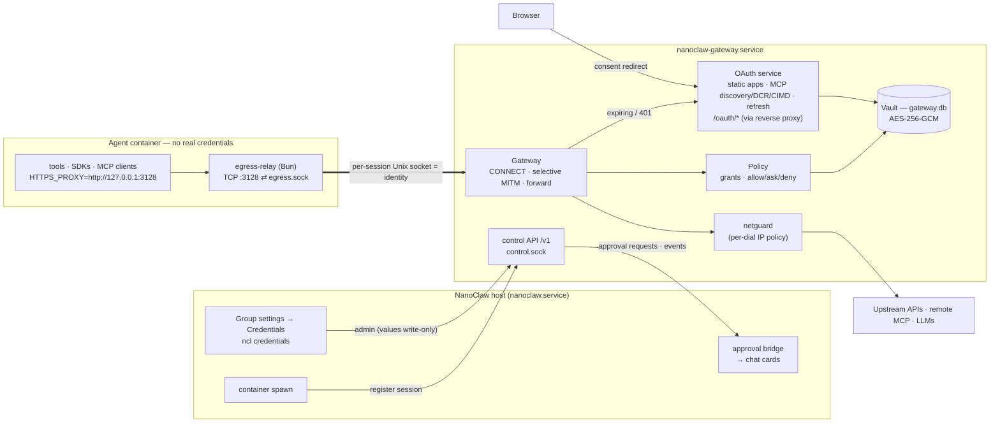

# Native credential gateway: retire OneCLI

**Status:** proposal. **Date:** 2026-10-15. **Revision 2:** the gateway runs
as its own service rather than inside the host process (see
[§2.1](#21-deployment-topology)). **Alternative:**
[credential-gateway-agent-vault-fork-proposal.md](credential-gateway-agent-vault-fork-proposal.md)
reaches the same goals by forking Infisical Agent Vault.

Replace the external OneCLI gateway with a native credential gateway,
`nanoclaw-gateway`. It lives in this repo but runs as a separate service. It
injects static and OAuth credentials into agent egress and adds MCP OAuth 2.1
(discovery + dynamic client registration). Containers never hold real
credentials. Proven designs are borrowed from MIT/Apache projects rather than
invented; see [§3](#3-borrowed-building-blocks).

## 1. Goals and non-goals

**Goals**

- Feature parity with what this install uses from OneCLI today:
  - 15 static secrets: header / Basic / query-parameter injection with host and
    path globs, plus the Anthropic type.
  - Google OAuth apps with multiple accounts.
  - `onecli-managed` credential stubs for stdio MCP servers.
  - Per-agent grants.
  - Per-request approval cards.
  - Egress lockdown.
  - Host-side OpenRouter calls.
- **New:** remote MCP servers that require OAuth 2.1, connecting through
  RFC 9728 discovery, RFC 7591 dynamic client registration (DCR) or a Client ID
  Metadata Document (CIMD), PKCE and RFC 8707 resource indicators.
- Works unchanged for the `native`, `claude` and `opencode` providers and for
  any CLI that honors `HTTPS_PROXY`.
- No third-party service. The gateway is NanoClaw-owned code with a narrow,
  versioned API to the host. It can restart or fail without the host, and can
  later move to another machine without a redesign.

**Non-goals:** multi-tenant SaaS, a hardware key store, HTTP/2 to the agent, or
non-HTTP protocols (ssh, raw TCP, UDP).

## 2. Architecture

- **Identity comes from the socket.** When the host registers a session, the
  gateway binds a dedicated `egress.sock` for it. The host mounts that socket's
  directory into the container, the same model as
  [session-link.md](session-link.md).
  - There's no proxy token in the env that could leak.
  - With lockdown, the container runs with `--network none`.
- **The gateway only intercepts TLS where a credential applies.**
  - Hosts with a granted binding are intercepted (TLS terminated in the gateway).
  - All other hosts get a blind TCP tunnel, or a 403 if the group's policy is
    `deny`.
  - So certificate-pinned and bulk traffic is never inspected.
- **MCP OAuth is just another credential.** A remote MCP server's token becomes
  a vault credential bound to the server's host and path prefix. No separate
  MCP proxy is needed and the container has no OAuth code.

### 2.1 Deployment topology

**Process boundary**

- **Code:** `src/gateway/` has its own entrypoint (`src/gateway/main.ts`) and its
  own SQLite DB (`data/gateway/gateway.db`). It shares only wire types with the
  host, through `src/gateway-protocol/`. The host talks to it through one client
  module, `src/modules/credentials/client.ts`.
- **Service:** `nanoclaw-gateway.service` runs as a user-level systemd unit (a
  launchd plist on macOS). `nanoclaw.service` declares
  `Wants=`/`After=nanoclaw-gateway.service`. Setup, uninstall and `/debug` treat
  it as a first-class unit.

**Control API**

The API is HTTP over `data/gateway/control.sock` (0600, host user only),
versioned `/v1`. The host checks `GET /v1/health` (version and readiness) at
boot.

| Call                                                       | Direction                    | Purpose                                                                                                                                 |
| ---------------------------------------------------------- | ---------------------------- | --------------------------------------------------------------------------------------------------------------------------------------- |
| `POST /v1/sessions {sessionId, principal}`                 | host → gateway, before spawn | Binds the socket and returns the socket directory, env, CA bundle and stubs. This is the equivalent of OneCLI's `applyContainerConfig`. |
| `DELETE /v1/sessions/:id`, `PUT /v1/sessions` (full list)  | host → gateway               | Ends a session; reconciles the full list after either side restarts                                                                     |
| `/v1/admin/*`                                              | host UI and `ncl` → gateway  | CRUD for credentials, services, grants, rules and proposals. Values can be written but never read back.                                 |
| `GET /v1/approvals` (long-poll), `POST /v1/approvals/:id`  | gateway ⇄ host               | The `ask` flow. Replaces OneCLI's `configureManualApproval`.                                                                            |
| `GET /v1/events?after=<cursor>`                            | gateway → host               | `connected`, `needs_reconnect` and `proposal_created`. Delivered at least once, resumed from a cursor.                                  |
| `CONNECT`/forward on `control.sock` as principal `host:ui` | host → gateway               | Host-side credentialed calls (§4.8)                                                                                                     |

**Who owns what**

| Owner   | What it owns                                                                                                                                                                            |
| ------- | --------------------------------------------------------------------------------------------------------------------------------------------------------------------------------------- |
| Gateway | Vault, CA, egress sockets, grants, rules, per-principal egress policy, OAuth state, the `/oauth/*` HTTP listener (`127.0.0.1`, published through the existing reverse proxy), usage log |
| Host    | Users and roles, agent groups (the gateway sees them only as opaque principal IDs), container lifecycle, MCP server config, chat delivery of approval cards and connect links           |

**Lifecycle and failure**

- **Spawn:** if session registration fails, the spawn is refused and retried on
  the next sweep, as with OneCLI today.
- **Gateway restart:**
  - Registrations persist.
  - Sockets are rebound in the same mounted directories, so running containers
    reconnect.
  - Requests that were in flight are lost.
- **Host restart or redeploy:** egress keeps working, including long-lived MCP
  streams. The host reconciles sessions and resumes events from its cursor.
- **Host down while an `ask` is pending:** the request times out and is denied.

**Trust model and topologies**

- **A: same machine (default).**
  - **What it isolates:** operations only (restarts, crashes, resource limits,
    smaller attack surface).
  - **What it doesn't:** it is **not** a security boundary against a compromised
    host. The host controls Docker, which makes it root-equivalent, so it can
    read the gateway's key or attach to the process.
  - **Compared with today:** the same as the OneCLI container on this machine.
- **B: separate VM (optional, later).**
  - **Transport:** a host-side forwarder serves the container's `egress.sock`
    and dials the gateway over mutual TLS (mTLS). It adds a per-session token in
    `Proxy-Authorization`. The token stays in the host forwarder and never
    reaches the container.
  - **Admin:** secret entry, new OAuth/MCP connections and binding changes are
    allowed only through the gateway-local CLI on the VM. The gateway has no web UI.
  - **What a compromised host could still do:** misuse granted credentials
    through the proxy (audited and bounded by policy) and approve requests
    automatically.
  - **What it couldn't do:** read secret values, or redirect them to other hosts.
- **Making B a config change:** **sealed bindings** are on in both topologies.
  Each secret's allowed hosts are inside its ciphertext and can't be changed;
  changing a host means re-entering the value. The host client also accepts
  either `GATEWAY_URL=unix:…` or `https://…` from day one.

## 3. Borrowed building blocks

What we take from each project, and how. "Port" means re-implementing in
TypeScript with attribution in the file header. Pinned revisions:

- Agent Vault: `872578e4cdf9`
- smokescreen: `7d0ddfa75899`
- MCP SDK: `1.29.0`

| From                                                                                                        | License                              | What we take                                                                                                                                                                                       | How                                                                                                             |
| ----------------------------------------------------------------------------------------------------------- | ------------------------------------ | -------------------------------------------------------------------------------------------------------------------------------------------------------------------------------------------------- | --------------------------------------------------------------------------------------------------------------- |
| [Infisical Agent Vault](https://github.com/Infisical/agent-vault): `internal/mitm/connect.go`, `forward.go` | MIT (core only; nothing under `ee/`) | CONNECT handling details (below)                                                                                                                                                                   | Port                                                                                                            |
| Agent Vault: `internal/brokercore/substitution.go`, `body.go`                                               | MIT                                  | Placeholder substitution (below)                                                                                                                                                                   | Port                                                                                                            |
| Agent Vault: services model                                                                                 | MIT                                  | Service fields: `host[:port][/path-glob]`, auth types `bearer`, `basic`, `api-key` (header + prefix), `custom` (header templates) and `passthrough`; unmatched-host policy `passthrough` or `deny` | Port the schema                                                                                                 |
| Agent Vault: `internal/brokercore/credential.go`, `internal/oauth/*`                                        | MIT                                  | OAuth refresh (below)                                                                                                                                                                              | Port                                                                                                            |
| Agent Vault: `internal/ca/soft.go`, `lru.go`                                                                | MIT                                  | Root CA with 10-year validity, key encrypted with the vault key and stored in the DB; leaves valid 24 h; LRU leaf cache that checks expiry; SNI validation                                         | Port                                                                                                            |
| Agent Vault: proposals, `internal/catalog/catalog.go`                                                       | MIT                                  | **Proposals:** the agent asks for a service plus a credential "slot", and a human fills in the value through a link. **Catalog:** presets for common services.                                     | Port the flow and the presets                                                                                   |
| Agent Vault: `internal/netguard/netguard.go`                                                                | MIT                                  | Netguard (below)                                                                                                                                                                                   | Port                                                                                                            |
| [stripe/smokescreen](https://github.com/stripe/smokescreen): `classifyAddr`                                 | MIT                                  | Netguard additions (below)                                                                                                                                                                         | Port                                                                                                            |
| [superfly/tokenizer](https://github.com/superfly/tokenizer)                                                 | Apache-2.0                           | Host-bound secrets (below)                                                                                                                                                                         | Concept only                                                                                                    |
| [mitmproxy](https://github.com/mitmproxy/mitmproxy): `certs.py`                                             | MIT                                  | Reuse **one leaf key** for every minted certificate, so there's no per-host key generation                                                                                                         | Concept                                                                                                         |
| [MCP TypeScript SDK](https://github.com/modelcontextprotocol/typescript-sdk): `client/auth.ts`              | MIT                                  | MCP OAuth glue (below)                                                                                                                                                                             | Port the glue only. The SDK itself isn't added to the gateway, because it pulls in ~17 deps (express, hono, …). |
| [`oauth4webapi`](https://github.com/panva/oauth4webapi) 3.8.8                                               | MIT, no deps                         | Protocol primitives: RFC 9728 resource discovery, RFC 8414 discovery, DCR, PKCE, code and refresh grants, client authentication methods                                                            | **Dependency**                                                                                                  |
| [`node-forge`](https://github.com/digitalbazaar/forge) 1.4.0                                                | BSD-3, no deps                       | Assembling and signing X.509 certificates. Keys are generated with `node:crypto`; forge is used only for certificate encoding.                                                                     | **Dependency**                                                                                                  |
| This repo: [onecli-approvals.ts](../src/modules/approvals/onecli-approvals.ts)                              | —                                    | Held-request approval cards, short IDs for Telegram's 64-byte callback limit, expiry handling and the startup sweep                                                                                | Becomes the host-side approval bridge (§2.1), action `credential_use`                                           |

**Details for the Port rows:**

- **CONNECT handling (Agent Vault):**
  - The target comes from the CONNECT line, so later `Host` rewrites are ignored.
  - Agent-side TLS is ≥1.2 and the only ALPN offered is `http/1.1`.
  - Timeouts: 10 s request headers, 60 s request read, 30 min write, 2 min idle,
    5 min upstream response headers.
  - Hop-by-hop headers are stripped. Only the managed "auth slot" header is
    overridden; vendor headers pass through. SSE and WebSocket are passed
    through.
- **Placeholder substitution (Agent Vault):**
  - The placeholder can be substituted only in the surfaces declared for it:
    `header`, `query`, `path` or `body`.
  - A value containing CR or LF is rejected (header-injection guard).
  - Body encoding follows the content type (JSON string escaping, form escaping).
  - Compressed and multipart bodies are skipped.
  - Bodies are streamed, and only buffered (up to a cap) when a body
    substitution applies.
- **OAuth refresh (Agent Vault):**
  - Tokens are refreshed 5 minutes before they expire.
  - Concurrent refreshes of the same credential are collapsed into one.
  - A rotated refresh token is persisted atomically.
  - 400 and 401 responses from the token endpoint are treated as permanent and
    mark the credential "needs reconnect".
- **Netguard (Agent Vault):** the IP policy runs on **every dialed address**, in
  the DNS lookup hook, so DNS rebinding can't slip an unchecked IP through.
  Cloud metadata IPs (IMDS) are always blocked; private ranges are blocked unless
  allowlisted.
- **Netguard additions (smokescreen):** also reject IPv6 addresses that embed an
  IPv4 address (NAT64 `64:ff9b::/96` and `64:ff9b:1::/48`, 6to4, Teredo), reject
  connections back to the host's own IPs, and add a per-host IP-filter bypass list.
- **Host-bound secrets (tokenizer):** each secret carries its **own allowed-host
  list inside the ciphertext**. A tampered binding row therefore can't redirect a
  secret to another host; these are the sealed bindings in §2.1. Also borrowed:
  tokenizer's rule that query-parameter injection replaces an existing
  parameter.
- **MCP OAuth glue (MCP SDK):** the discovery URL fallback order (path-aware
  `.well-known`, then OIDC), `resource_metadata` parsing from
  `WWW-Authenticate`, resource-URL selection, and the CIMD `clientMetadataUrl`
  behavior.

**Considered but not used:**

- **agentgateway, ContextForge, Obot, Docker MCP Gateway:** MCP-only control
  planes, and too heavy for one host.
- **Nango:** licensed under ELv2, not OSI open source.
- **mcp-remote:** keeps tokens inside the container.
- **`@peculiar/x509`:** version 2.2.0 was published today, so it fails the
  release-age gate, and it has 11 dependencies.

## 4. Components

### 4.1 Transport

- **Gateway side:**
  - On `POST /v1/sessions`, the gateway binds
    `data/gateway/sessions/<session>/egress.sock` (mode 0666) and returns that
    directory.
  - The host mounts the directory rather than the socket file, so a restarted
    gateway can rebind it, as session-link does.
  - In topology B, the host-side forwarder serves the same path instead.
- **Container side:** `egress-relay.ts` starts first in `index.ts` and
  `mcp-probe.ts`.
- **Container env:**
  - Proxy: `HTTP(S)_PROXY`, `NO_PROXY=127.0.0.1,localhost`, `NODE_USE_ENV_PROXY=1`.
  - CA bundle: `SSL_CERT_FILE`, `NODE_EXTRA_CA_CERTS`, `CURL_CA_BUNDLE`,
    `GIT_SSL_CAINFO`, `REQUESTS_CA_BUNDLE`, `DENO_CERT`. They point at a
    combined bundle (system CAs plus the install CA) mounted read-only.
  - Placeholders, e.g. `ANTHROPIC_API_KEY=placeholder`.

### 4.2 Injection

A **service** is a match pattern (`host[:port][/path]`) plus one of these auth
types:

| Auth type     | What the gateway does                                                                                 |
| ------------- | ----------------------------------------------------------------------------------------------------- |
| `bearer`      | Sets `Authorization: Bearer <secret>`                                                                 |
| `basic`       | Sets `Authorization: Basic …`                                                                         |
| `api-key`     | Sets a named header, with an optional prefix                                                          |
| `query`       | Sets a query parameter; an existing one is replaced                                                   |
| `custom`      | Fills header templates                                                                                |
| `anthropic`   | `x-api-key` for API keys; for `sk-ant-oat` OAuth tokens, `Authorization: Bearer` plus the beta header |
| `passthrough` | Allowlists the host without injecting anything                                                        |

Rules:

- **Auth slot overrides:** the gateway removes whatever the agent sent in the
  managed header (or query parameter) and sets the real value.
- **Placeholder substitutions:** only in the surfaces declared for that
  credential.
- **Most specific match wins:** if several services match, the longest host plus
  path pattern is used.

### 4.3 Vault

- **Storage:** AES-256-GCM with a random nonce. The additional authenticated
  data (AAD) is `credential_id ‖ kind ‖ key_version ‖ allowed_hosts`, so
  ciphertexts can't be swapped between rows and bindings are sealed.
- **Key:** `NANOCLAW_GATEWAY_KEY` (systemd `LoadCredential=` on the gateway unit
  is preferred), otherwise `data/gateway/master.key` (0600). The host never
  reads it. `ncl credentials rotate-key` re-encrypts every row and can be
  resumed if interrupted.
- **Where values can be entered:**
  - **Allowed (topology A):** group settings → Credentials in the NanoClaw UI
    (owner, global admin, or a scoped admin when the change affects only that
    group) and
    host-side `ncl credentials set --value-stdin`, which relay to
    `/v1/admin/*`.
  - **Allowed (topology B):** only the gateway-local CLI on the VM.
  - **Write-only:** stored values are never displayed again.
  - **Never:** values are never accepted from container `ncl` or from chat.

### 4.4 OAuth

- **OAuth apps with a pre-registered client** (Google first, from catalog
  presets):
  - The operator enters a client ID and secret.
  - Sign-in uses the authorization-code flow with PKCE, redirecting to
    `<UI_BASE_URL>/oauth/callback`. The reverse proxy routes `/oauth/*` to the
    gateway's listener, so the host never sees authorization codes.
  - All Google scopes for one account are merged into a single connection, so
    each account needs only one consent.
  - With several accounts, a grant's default account is used. A tool can choose
    another with the `X-NanoClaw-Account` header, which the gateway strips.
- **Stubs:** at spawn, files are written from preset templates using the
  `nanoclaw-managed` placeholder. `onecli-managed` is also accepted, permanently.
  Token-endpoint calls that carry a placeholder refresh token get a synthetic
  response; the real refresh happens in the gateway.
- **MCP OAuth:**
  1. **Triggers:**
     - `add-mcp-server --url` or the UI asks the gateway to probe the server.
     - Or the gateway sees a 401 from a host in that group's MCP config. The
       host includes the MCP URLs in the session registration.
  2. RFC 9728 discovery, then RFC 8414 (falling back to OIDC discovery).
  3. Client registration, in order of preference: CIMD (served at
     `<UI_BASE_URL>/oauth/client-metadata.json`), then DCR (cached per issuer),
     then a manual client.
  4. PKCE S256 plus `resource` on both the authorize and token requests.
  5. Store the credential and bind it to the MCP URL's host and path prefix.
  6. The gateway emits a `connected` event, and the host restarts the group
     with an `on_wake` "connected" message.
- **Hiding the challenge from the container:** the gateway removes
  `resource_metadata` from 401s it passes back to the container. That keeps the
  in-container SDKs from starting their own OAuth flow; the agent gets the error
  contract in §4.6 instead.
- **Connect links:** single-use, expiring after 10 minutes, and served at
  `/oauth/start/<state>`, which **requires an authenticated owner or admin**.
  - **Topology A:** a one-time ticket that the host UI mints for the signed-in
    admin.
  - **Topology B:** an operator runs the gateway-local CLI; the host only
    relays the callback.
  - This blocks account injection: someone who obtains the link can't bind their
    own account to the agent.

### 4.5 Policy and approvals

- **Evaluation order:** netguard → grant → the most specific
  `(method, path-glob)` rule → the grant's default action (`allow`, `ask` or
  `deny`).
- **`ask`:** the gateway holds the request and publishes it on
  `/v1/approvals`. The host bridge delivers the card and posts back the
  decision. A timeout, or the host being unreachable, counts as deny.
  Optional "approve for N minutes" caches the decision per (grant, method,
  path).
- **Presets** provide named rule sets, e.g. `gmail.send` →
  `POST /gmail/v1/users/*/messages/send`.
- **Audit:** `credential_usage` records time, group, session, credential, host,
  method, path, status and decision. Never bodies or values. Kept 30 days.

### 4.6 Agent contract

- **Errors keep OneCLI's field names**, so existing skills and
  [upload-trace.ts](../container/agent-runner/src/upload-trace.ts) keep working:
  - `401 {"error":"credential_not_connected","connect_url":…}`
  - `403 {"error":"credential_denied" | "approval_expired"}`
- **New MCP tool `request_credential`:** creates a proposal (service + slot, or
  an OAuth/MCP connection) and returns a link to the approver. The agent never
  supplies or sees a value.
- **Skill:** the `onecli-gateway` container skill becomes `credential-gateway`,
  keeping the same rules.

### 4.7 Lockdown

- **`NANOCLAW_EGRESS_LOCKDOWN=true`** runs containers with `--network none`; the
  relay socket is then the only way out.
- **Hosts on private networks** (e.g. Home Assistant at `10.0.1.105:8087`) are
  opted into per principal in the gateway's egress policy (`allow_private`).
  The policy lives in the gateway, so even a compromised host in topology B
  can't open them.
- **Optional per-principal allowlist:** `hosts` limits which hosts blind
  tunnels may reach.

### 4.8 Host-side callers

- `credentialFetch(url, init)` in the host client proxies the call through
  `control.sock` as principal `host:ui`, with the same matching, policy and
  audit as container traffic. It replaces
  [onecli-proxy.ts](../src/ui/server/chat/onecli-proxy.ts).
- The OpenCode `models.dev` `NO_PROXY` workaround is removed, because hosts with
  no binding are now tunneled blindly.

## 5. Data model (gateway DB `data/gateway/gateway.db`)

The central DB only gains `container_configs.credential_backend`. Everything
below lives in the gateway's own DB and is migrated by the gateway. Principals
are opaque IDs (agent group IDs, plus `host:ui`).

| Table                                    | Purpose                                                                                                               |
| ---------------------------------------- | --------------------------------------------------------------------------------------------------------------------- |
| `credentials`                            | id, key, kind (`static` \| `oauth`), label, ciphertext, nonce, key_version, status, expires_at, last_used_at          |
| `credential_services`                    | match pattern, auth config (references credential keys), `enabled`                                                    |
| `oauth_providers`                        | catalog preset or custom endpoints; encrypted client ID and secret; scopes; stub templates                            |
| `oauth_clients`                          | MCP issuer + resource, client ID and encrypted secret, method (`cimd` \| `dcr` \| `manual`)                           |
| `oauth_pending`                          | state, PKCE verifier, agent group, target, initiator, expiry (single-use)                                             |
| `credential_grants` / `credential_rules` | per-group access, default action, per-(method, path) rules                                                            |
| `credential_proposals`                   | agent-initiated requests waiting for a human                                                                          |
| `credential_usage`                       | audit log (metadata only)                                                                                             |
| `credential_ca`                          | root certificate PEM and encrypted root key                                                                           |
| `gateway_sessions`                       | session ID, principal, socket directory, MCP URLs, created_at (used to rebind after a restart)                        |
| `gateway_events`                         | cursor-ordered `connected` / `needs_reconnect` / `proposal_created` events for the host; pruned after acknowledgement |
| `egress_policies`                        | per-principal `allow_private`, blind-tunnel `hosts` allowlist, unmatched-host policy                                  |

## 6. Dependencies needing approval

Both pass the 3-day `minimumReleaseAge` gate, have no transitive dependencies,
and have no install scripts.

| Package              | Purpose                                | Published  |
| -------------------- | -------------------------------------- | ---------- |
| `oauth4webapi@3.8.8` | OAuth protocol primitives              | 2026-09-05 |
| `node-forge@1.4.0`   | X.509 certificate encoding and signing | 2026-03-24 |

The alternative to `node-forge` is a ~200-line DER writer for a fixed
certificate shape, which would allow ECDSA. It's deferred unless forge's
performance or security track record becomes a concern.

## 7. Rollout

Each phase is switched on per group with
`container_configs.credential_backend = onecli | native`, which defaults to
`onecli` until P5.

| Phase         | Scope                                                                                                                                                                                                                            | Exit criterion                                                                                                                                                                                             |
| ------------- | -------------------------------------------------------------------------------------------------------------------------------------------------------------------------------------------------------------------------------- | ---------------------------------------------------------------------------------------------------------------------------------------------------------------------------------------------------------- |
| P0            | Gateway daemon skeleton, `nanoclaw-gateway` unit, setup/uninstall/`/debug` steps, control API `/v1` (health, sessions, admin), host client, vault and crypto, `ncl credentials`, group settings → Credentials for static secrets | Encrypt/decrypt, AAD tamper, sealed-binding and key-rotation tests pass; the host refuses to spawn `native` groups while the gateway is down                                                               |
| P1            | Relay, egress sockets, CA, injection, substitutions, netguard, blind tunnels, session reconciliation                                                                                                                             | A canary group works end to end with Anthropic, Tavily (query), NextCloud (Basic), domagent (path-scoped) and Linear MCP; egress survives a host restart, and containers reconnect after a gateway restart |
| P2            | Grants, rules, approval bridge, events, usage log, egress policies, `--network none` lockdown                                                                                                                                    | Approval round-trip works; lockdown blocks direct egress, IMDS, private IPs and NAT64                                                                                                                      |
| P3            | OAuth apps (Google preset), `/oauth/*` routing, stubs, token-endpoint interception, multiple accounts                                                                                                                            | Gmail and Calendar MCP servers from `/add-gmail-tool` and `/add-gcal-tool` work unchanged                                                                                                                  |
| P4            | MCP OAuth (discovery, CIMD/DCR/manual), proposals, `request_credential`                                                                                                                                                          | Linear MCP connects with no static token                                                                                                                                                                   |
| P5            | `scripts/migrate-from-onecli.ts`: imports secret metadata, services and grants into the gateway; values and refresh tokens can't be exported, so items show as "needs value" or "needs reconnect". Default switches to `native`. | All groups on `native` for 7 days                                                                                                                                                                          |
| P6            | Delete `@onecli-sh/sdk`, `onecli-*.ts`, OneCLI setup/uninstall steps, and docs                                                                                                                                                   | `rg -i onecli src container setup` returns only the stub-compat constant                                                                                                                                   |
| P7 (optional) | Topology B: host-side forwarder plus mTLS, gateway-local CLI for admin, admin through the host disabled                                                                                                                          | Gateway on a separate VM; red-team check: a compromised host can't read values or rebind a secret                                                                                                          |

**Operator work at cutover:** re-enter about 15 secret values and do one Google
consent per account.

## 8. Risks and open questions

1. **Two services to operate.**
   - **Startup order:** the host's `Wants=`/`After=` on the gateway unit, plus
     refusing to spawn while the gateway is down.
   - **Version skew:** the host checks the `/v1` version at boot.
   - **On failure:** if the gateway is down, egress fails closed. The gateway
     is a single point of failure for egress, but no longer for the router.
2. **Separation on one machine is not a security boundary.** See §2.1;
   topology B is the remedy if a compromised host must not reach secret values.
3. **Tools that ignore `HTTPS_PROXY`** fail under lockdown, the same as today.
4. **Apple container runtime:** directory-mounted sockets are assumed to work
   because session-link already relies on them. This needs checking in P1.
5. **Approval scope:** should `ask` approve each call, or a time window by
   default?
6. **Keeping ported code current:** record the upstream revisions in file
   headers and review upstream security fixes quarterly.
